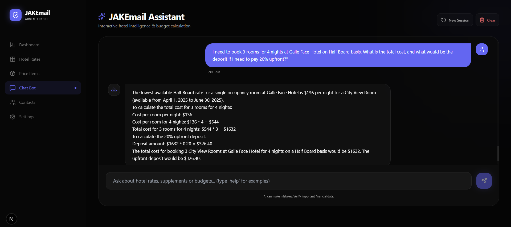
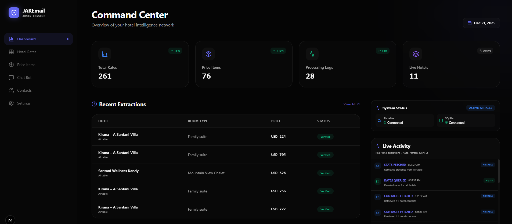
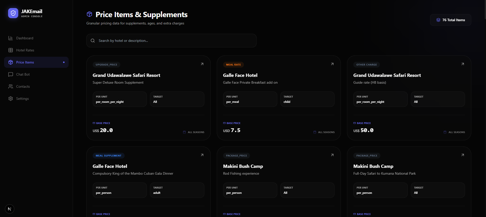
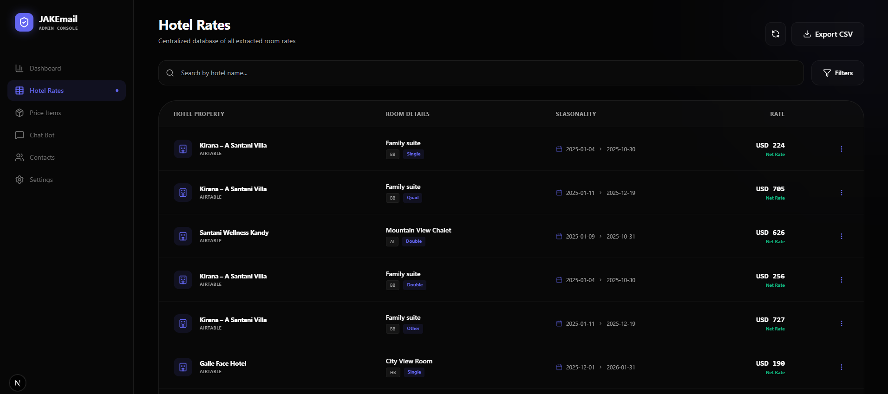
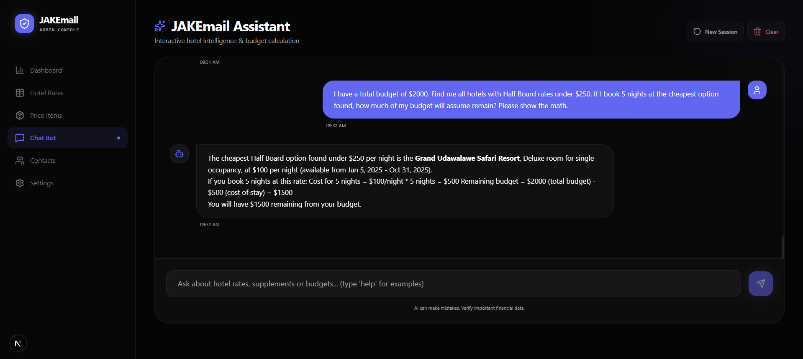

# JAK Travel Agency Email Automation System

## Project Overview

Enterprise-grade automation system designed for travel agencies to process hotel rate communications. The system automatically extracts structured data from hotel rate emails (PDFs and images), stores information in normalized databases, and provides natural language query capabilities through an LLM-powered chat interface. Includes a comprehensive admin dashboard for data management and analytics.

## Tech Stack

**Backend:**
- Python 3.10+
- FastAPI (REST API)
- SQLite (primary database)
- Airtable API (cloud sync)

**Frontend:**
- Next.js 16.1.0
- React 19.2.3
- TypeScript 5
- Tailwind CSS 3.4

**AI/ML:**
- Google Gemini (text parsing and function calling)
- Tesseract OCR (image text extraction)
- LangChain paradigm (multi-turn conversations)

**Infrastructure:**
- Microsoft Graph API (email integration)
- Google Custom Search API (web scraping)
- MSAL (Microsoft authentication)

**Development:**
- pytest (testing)
- python-dotenv (configuration)
- black/flake8 (code quality)

## Key Features

- Automated email processing with Microsoft Outlook integration via Graph API
- PDF and image text extraction using pdfplumber and Tesseract OCR
- LLM-powered parsing to convert unstructured rate data into normalized database records
- Dual-database architecture with local SQLite and cloud Airtable synchronization
- Natural language chat interface for querying rates, calculating budgets, and discovering hotel contacts
- API key rotation system to maximize free-tier LLM usage across multiple Google accounts
- Web-based admin dashboard with real-time statistics and hotel management capabilities
- Resilient architecture with automatic fallback when external services are unavailable

## Project Structure

```
JAKEmailBot/
├── admin_dashboard/         # Web-based admin interface
│   ├── backend/             # FastAPI REST API server
│   └── frontend/            # Next.js TypeScript application
├── calculator/              # Budget calculation engine
├── chat/                    # Natural language query interfaces
│   ├── chat_interface.py    # Basic query handler
│   └── smart_chat_interface.py # Advanced function-calling interface
├── database/                # Data persistence layer
│   ├── db_init.py           # SQLite schema initialization
│   ├── insert_rates.py      # Data insertion logic
│   ├── query_rates.py       # Rate query operations
│   ├── airtable_client.py   # Cloud database sync
│   └── hotel_management.py  # Hotel CRUD operations
├── email_handler/           # Email operations
│   ├── outlook_reader.py    # Microsoft Graph email retrieval
│   ├── outlook_sender.py    # Draft email creation
│   └── notifications.py     # Internal alerting system
├── extractor/               # Data extraction pipeline
│   ├── pdf_text_extractor.py # PDF parsing
│   ├── image_ocr_extractor.py # OCR processing
│   └── rate_parser.py        # LLM-based data structuring
├── llm/                     # LLM integration layer
│   ├── llm_client.py        # Multi-key client with rotation
│   ├── prompts.py           # Structured prompt templates
│   └── itinerary_extractor.py # Budget calculation prompts
├── workflow/                # Automation orchestration
│   ├── hotel_discovery_agent.py # Web scraping for contacts
│   └── rate_refresh_service.py  # Scheduled rate updates
├── scripts/                 # Operational utilities
│   ├── setup/               # Initial configuration scripts
│   ├── verification/        # System health checks
│   ├── migration/           # Database schema migrations
│   └── ops/                 # Operational maintenance
├── tests/                   # Test suite
├── utils/                   # Shared utilities
│   ├── logger.py            # Centralized logging
│   └── file_storage.py      # Attachment management
├── main.py                  # Primary workflow orchestrator
├── config.py                # Environment configuration
└── requirements.txt         # Python dependencies
```

## How to Run Locally

### Prerequisites

- Python 3.10 or higher
- Node.js 18.0 or higher
- Tesseract OCR
- Microsoft 365 account with Graph API credentials
- Google Gemini API key
- Git

### Installation Steps

**1. Clone the repository**

```bash
git clone <repository-url>
cd JAKEmailBot
```

**2. Set up Python environment**

```bash
python -m venv venv

# Windows
venv\Scripts\activate

# macOS/Linux
source venv/bin/activate

pip install -r requirements.txt
```

**3. Install Tesseract OCR**

- Windows: Download from [GitHub releases](https://github.com/UB-Mannheim/tesseract/wiki) and install to `C:\Program Files\Tesseract-OCR`
- macOS: `brew install tesseract`
- Linux: `sudo apt-get install tesseract-ocr`

**4. Configure environment variables**

Create a `.env` file in the project root (see `.env.example` for template):

```env
# Microsoft Graph API
AZURE_CLIENT_ID=<your_client_id>
AZURE_CLIENT_SECRET=<your_client_secret>
AZURE_TENANT_ID=<your_tenant_id>
OUTLOOK_EMAIL=<your_email@example.com>

# Google Gemini API (supports multiple keys)
GOOGLE_API_KEY_1=<your_gemini_key_1>
GOOGLE_API_KEY_2=<your_gemini_key_2>

# Google Custom Search (optional, for hotel discovery)
GOOGLE_SEARCH_API_KEY=<your_search_key>
GOOGLE_SEARCH_CX=<your_search_engine_id>

# Database
DB_PATH=data/rates.db

# Airtable (optional)
AIRTABLE_API_KEY=<your_airtable_key>
AIRTABLE_BASE_ID=<your_base_id>

# OCR
TESSERACT_PATH=C:\Program Files\Tesseract-OCR\tesseract.exe

# Notifications
NOTIFICATION_EMAIL=<alerts@example.com>
ENABLE_NOTIFICATIONS=true
```

**5. Initialize the database**

```bash
python -c "from database.db_init import initialize_database; initialize_database()"
```

**6. Run the main email processing workflow**

```bash
python main.py
```

**7. (Optional) Start the admin dashboard**

Backend:
```bash
cd admin_dashboard/backend
python main.py
```

Frontend (in a separate terminal):
```bash
cd admin_dashboard/frontend
npm install
npm run dev
```

Access the dashboard at `http://localhost:3000`

**8. (Optional) Use the chat interface**

```bash
python -m chat.smart_chat_interface
```

### Verification

Run the test suite to verify installation:

```bash
pytest tests/
```

## Database Schema

The system uses a normalized 3NF relational schema:

- **hotels** - Hotel information and contact details
- **room_types** - Room types linked to hotels
- **meal_plans** - Global meal plan definitions
- **rates** - Base room rates by date range
- **price_items** - Granular pricing (meal supplements, gala dinners, extras)
- **contract_data** - Cancellation policies, payment terms, special conditions
- **processing_log** - Email processing status and audit trail

## Future Improvements

- Implement scheduled task execution using cron or Windows Task Scheduler
- Add support for additional email providers beyond Outlook
- Implement parallel processing for multiple emails to improve throughput
- Develop mobile-responsive progressive web app for dashboard
- Add rate comparison analytics and historical trend visualization
- Implement automated rate anomaly detection and alerting
- Support additional document formats (Excel, Word, scanned documents)

## Screenshots

Dashboard and interface screenshots will be added here.

## License

Copyright (c) 2025. All rights reserved.

This software is proprietary and confidential. Unauthorized copying, distribution, modification, or use of this software, via any medium, is strictly prohibited without express written permission from the copyright holder.

For licensing inquiries, contact the repository owner.

## Demo Screenshots

### Chat Interface - Budget Calculations


### Admin Dashboard - Command Center


### Price Items & Supplements


### Hotel Rates Database


### Chat Interface - Multi-Room Booking


## Additional Documentation

- [DEPLOYMENT.md](DEPLOYMENT.md) - Comprehensive deployment guide for production environments
- Additional technical documentation available in respective module directories
